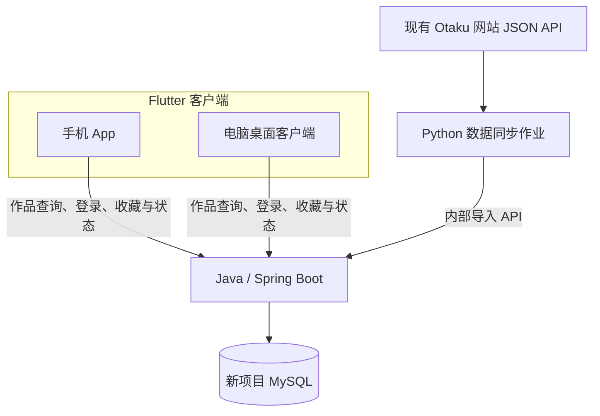

# 跨平台适配与客户端方案 · 项目规划 v0.2

> 项目规划 v0.2 · 2026-10-19 · 三人协作讨论稿
>
> 本文档描述目标与建议方案，不代表功能已经实现。文中的“跨平台”明确指手机 App 与电脑桌面客户端共同使用同一套服务，并通过同一账号同步个人数据。目标操作系统、共享接口及验收标准由团队共同确认。
>
> **本文聚焦产品范围、架构与阶段验收。** 项目目标、定位、分工与协作规则见根目录 [`README.md`](../README.md)；来源站结论见 [`旧站能力复用清单`](旧站能力复用清单)；第一阶段契约见 [`stage1-minimal-contract.md`](stage1-minimal-contract.md)。

## 1. 项目定位

本项目是**面向多个独立网站的跨平台适配与客户端解决方案**：让接入网站以较少重复开发获得 Web / 移动端 / 桌面端等客户端能力，各网站保留自己的品牌、业务逻辑与用户数据边界。完整定位见根目录 [`README.md`](../README.md) 第 1 节。

Otaku 是第一个接入对象，继续独立运营。**第一阶段只服务 Otaku 单站点**，多站点/租户适配不在第一阶段设计范围内。

具体到第一阶段的产品形态：用户在手机与桌面上浏览、搜索作品，并用同一账号在两端管理个人收藏与观看状态。

核心使用场景：

1. 用户在手机或电脑上浏览作品、搜索关键词、查看详情。
2. 用户使用同一账号登录两端，两端可以同时保持登录。
3. 手机将作品加入收藏，电脑刷新后可以看到。
4. 电脑将作品标记为“看过”，手机刷新后显示相同状态。

首期建议选择 **Android 手机端与 Windows 桌面端**作为验证组合，具体由团队根据开发设备确认。iOS、macOS、Linux 作为后续扩展目标，不默认纳入首期交付承诺。

## 2. 第一版范围

第一版分两步完成：先交付双端浏览闭环，再交付同账号的个人数据同步。只有两步都通过验收，才算完成本项目的最小可用版本。

### 2.1 双端浏览

- 首批只接入动画作品，建议使用 50–100 条真实数据开展联调。
- 手机与桌面均支持作品列表、分页、关键词搜索和作品详情。
- 详情至少展示标题、类型、简介及可用的来源评分；封面、年份、标签按实际接口能力补充。
- 两端都处理加载中、空结果、请求失败、重试和字段缺失。

### 2.2 个人作品管理

- 提供基础账号注册、登录、退出能力，账号由 Java 后端统一管理。
- 支持收藏、取消收藏，以及“想看 / 在看 / 看过”状态。
- 以收藏记录承载个人状态；加入收藏后状态可为空，取消收藏同时删除该条个人状态。
- 相同账号在两端读取同一份个人数据，不同账号的数据相互隔离。
- 手机和桌面都能提交修改，并在刷新或重新进入相应页面后取得服务端最新结果。

首期不要求实时推送、离线编辑合并、跨站账号互通、复杂推荐或 AI 画像。漫画、游戏、轻小说及更多来源在动画闭环稳定后逐步接入。

## 3. 总体架构

采用一个 Flutter 客户端工程、一个 Java 业务后端和一个 Python 数据同步模块。Flutter 分别构建手机与桌面应用，两端调用相同的 Java API。

### 3.1 Flutter：同一产品的两种界面

共享作品模型、API 调用、登录逻辑和业务状态；根据屏幕空间及输入方式调整界面。

- 手机端重点处理触控、窄屏布局、返回导航和输入法遮挡。
- 桌面端重点处理窗口缩放、宽屏布局、鼠标滚动、键盘输入与焦点。
- 所选网络、存储、凭据保存等依赖需要确认目标平台支持情况。
- 手机和桌面分别构建、运行和验收，不能仅凭一端运行成功推定另一端可用。

Flutter 提供桌面构建能力；共享代码时仍需按尺寸和输入方式进行适配。参考：[Flutter 桌面支持](https://docs.flutter.dev/platform-integration/desktop)、[自适应与响应式设计](https://docs.flutter.dev/ui/adaptive-responsive)。

### 3.2 Java：两端共用的业务服务

Java 统一管理作品查询、账号、收藏、观看状态及内部数据导入。MySQL 保存服务端的权威数据，只有 Java 写新项目业务库。

首期采用单个 Spring Boot 应用，按作品、用户、个人管理、数据导入划分内部模块。Python 不直接写业务数据库，Flutter 不直接调用数据源来拼装业务数据。

### 3.3 Python：作品数据的采集与同步

Python 从现有网站等约定来源读取作品数据，完成校验、清洗、字段转换，再通过内部 API 提交 Java。

首期以可手动执行、可定时运行的同步作业实现。需要具备有限重试、失败记录和安全重跑能力，不要求独立常驻 HTTP 服务。

> **待团队确认**：按根 README 第 3 节，Python 数据获取与处理**是否进入第一阶段最小闭环尚未定案**。若来源站已提供可用接口，闭环可以由「来源接口 → Java 适配 → Flutter 展示」直接构成，Python 作为字段补充路径（如封面、标签）。本节描述的是 Python 参与时的职责边界，不代表已确定纳入。

## 4. 现有网站如何服务于项目

现有网站：[Otaku](http://154.8.194.198:8000/)。其角色是首批作品数据来源与产品参考，原有网页可以继续运行。新项目的手机和桌面客户端共同使用新 Java 服务。

**来源站的实测结论、可复用能力与限流约束一律以 [`docs/旧站能力复用清单`](旧站能力复用清单) 为准**，本稿不重复记录（初版"只有五个字段"的判断已被推翻）。

与来源站协作的几条边界不变：

- 接入前先与网站维护者确认数据复用范围、调用方式和可调整的接口能力。
- 缺失封面、简介等应按契约显示占位或空值，不伪造字段，也不把抓取网页作为首期必需工作。
- 旧站数据库与新项目数据库相互独立，首期只做作品元数据单向导入。作品数据同步不能覆盖新项目中的账号、收藏、个人状态等用户数据。

### 4.1 其他网站如何接入（未来阶段）

每个接入网站都是**独立的数据来源**，互不影响：

- 站点以独立的 `source` 标识接入，`(source, source_id)` 在该站点内唯一；一个站点的 ID 不能当作另一个站点的 ID。
- 数据进入平台有两种方式，按站点能力选择：① 站点已有可用数据接口 → Python 同步到 Java；② 由 Java 侧直接适配站点接口。**平台对外始终只暴露 Java API，客户端不直连任何站点。**
  第一阶段采用 ①，其接入边界（拿什么、不拿什么、网站需具备什么能力）见 [`stage1-minimal-contract.md`](stage1-minimal-contract.md) 第 4 节。
- 各站点保留自己的品牌、业务逻辑与用户数据边界；平台不默认跨站共享账号、收藏、浏览历史。
- 多站点/租户适配不在第一阶段范围；Otaku 稳定后按同一模式接入其他站点。

### 4.2 客户端如何区分不同网站

- **第一阶段（仅 Otaku，已确认）**：客户端为**单站点构建**——在构建/配置中固定该站点的后端地址、站点标识与品牌资源，运行期不切换站点；多租户推迟到后续阶段。
- **未来多站点**：默认仍采用“每个站点一份客户端构建/配置”，复用同一套代码与组件，以符合各站独立品牌与运营；若确需“一个 App 多站点”，再引入 `site_id` 维度与站点选择机制（后续阶段）。

## 5. 明确两种“同步”

### 5.1 来源数据同步：Python → Java

目的是让新项目取得、更新作品资料。

- Java 为作品生成内部 `work_id`；来源记录使用独立的 `source` 和 `source_id`。
- `(source, source_id)` 建立唯一约束，同一记录重复导入不能生成重复作品。
- 来源 ID 只在该来源内有效，旧站 ID 不能猜作其他平台 ID。
- 不仅凭标题相同就合并漫画、动画、不同季或不同版本。
- 缺失字段不自动覆盖已有可靠内容；一次抓取失败或某条记录未出现，不代表作品已删除。
- 导入结果区分新增、更新、未变化和拒绝，失败记录应能定位和重新提交。
- 来源暂时不可用时，客户端仍可查询上一次成功入库的数据。

### 5.2 用户数据同步：手机 / 桌面 → Java → 另一端

目的是让同一账号在不同设备看到一致的个人作品管理结果。该过程由 Flutter 与 Java 完成，不经过 Python。

- 收藏和观看状态以服务端记录为准，至少按 `user_id + work_id` 唯一保存。
- 每个设备保持独立登录会话；一端正常登录不应自动把另一端踢下线。普通退出只结束当前端会话，不删除收藏或让另一端退出；重新登录后仍能读取原有个人数据。
- 客户端修改成功后使用后端返回的结果更新界面；请求失败时明确提示，不显示“已同步”。
- 另一端通过刷新、重新进入页面或应用回到前台后拉取更新；首期不承诺后台即时刷新。
- 首期建议采用“服务端最后成功提交的修改生效”，按服务端提交顺序处理，不使用设备本地时间决定先后。两端同时修改可能覆盖较早结果，应将此行为写入接口约定并测试。
- 修改接口只更新本次操作涉及的字段，避免旧界面提交整份记录而覆盖其他字段。状态修改要求收藏仍存在；若已在另一端取消收藏，应提示刷新，而不是由过期状态请求自动重新收藏。
- 写操作优先提交明确目标状态，例如“收藏=true”“状态=看过”，避免重试一个“切换状态”请求导致反向操作。失败请求不在后台无限重放。
- 首期网络不可用时提示无法修改；如保留本地缓存，只用于查看。退出或切换账号后，清理或隔离旧账号的个人缓存与凭据。

后续如果需要避免旧界面覆盖新修改，可以增加记录版本与冲突提示；实时推送及离线编辑另行设计。

## 6. 三人分工与共同责任

分工、自主范围与协作边界以根目录 [`README.md`](../README.md) 为准，此处只记录与本规划直接相关的职责：

- **Flutter 负责人**：交付手机与桌面两端可运行版本，验证相同业务操作在两端的表现。
- **Java 负责人**：数据库模型与迁移、作品查询、账号认证、个人作品管理、内部导入、权限校验与统一错误返回。
- **Python 负责人**：来源适配、样本准备、数据校验与转换、限速、超时重试、批量提交、同步结果记录及相关测试；保证同一批数据可安全重跑。

**共同责任**：围绕“手机收藏 → 电脑可见 → 电脑改状态 → 手机可见”共同联调，不以单个模块完成代替产品完成；影响其他模块的变更提前讨论，并同步文档与示例。

## 7. 先确定的最小契约

第一阶段的最小字段集与最小接口约定已在 [`docs/stage1-minimal-contract.md`](stage1-minimal-contract.md) 定稿（10 个字段、仅 4 个必填、唯一标识两层规则、两组接口约定），本稿不再重复。

本节只补充该文档未覆盖、但两端仍需共同确认的口径：

- **个人收藏**：用户 ID、作品 ID、可空观看状态、服务端更新时间；状态枚举两端一致。
- **来源评分**：明确评分来源与尺度，缺失值不视为 0 分，与个人评分分开。
- **共通约定**：字段类型、空值、错误码、时间格式、认证失败与无权限的处理。

公开网络上的账号与令牌通过 HTTPS 传输。客户端只保存自己所需的用户凭据，不持有数据导入服务的密钥。

## 8. 阶段与验收

### 阶段 0：确定范围与契约

确认首期手机和桌面操作系统，准备 10 条含空值、更新和同名情况的样本，完成接口示例、字段说明、个人状态规则及错误案例。三人可依据同一契约开展开发。

### 阶段 1：双端真实浏览

50–100 条动画数据进入 Java 与 MySQL（经 Python 导入，或由 Java 直接从来源接口适配——见 §3.3 待确认项）。手机和桌面分别完成列表、分页、搜索、详情；空结果、缺图、无简介和请求失败都有可用反馈。

验收必须实际运行手机端和桌面端；两端连接同一个 Java 实例。联调配置使用手机可访问的服务地址，不把电脑上的 `localhost` 直接当成手机的后端地址。

### 阶段 2：同账号跨端管理

准备账号 A 与 B，完成以下演示：

1. A 同时登录手机和电脑，两端均保持有效会话。
2. 手机收藏一部作品并设置“想看”，电脑刷新后看到相同结果。
3. 电脑改为“看过”，手机刷新后显示“看过”。
4. 一端取消收藏，另一端刷新后该条收藏和状态均消失。
5. B 看不到 A 的个人收藏；退出 A 并切换到 B 后不展示 A 的个人缓存。
6. 请求失败时不显示修改成功；两端同时修改的最终结果符合约定的提交顺序规则。
7. 退出手机后，电脑仍可使用；手机重新登录后，原有收藏和状态仍然保留。

阶段 1 和阶段 2 都通过后，才完成手机与桌面共同使用的最小产品目标。

### 阶段 3：可靠性与交付

- 相同来源数据导入两次，作品与来源映射数量不增长。
- 修改来源样本后，内部作品 ID 保持不变，字段按规则更新。
- Java 已保存但响应丢失时，Python 重试不产生重复作品。
- 坏记录可追踪并重试，来源异常不清空已有作品或个人数据。
- 未授权的导入请求被拒绝，普通用户不能读取或修改他人的个人数据。
- 团队成员按 README 能独立启动服务，并安装或运行约定的两端构建产物。

样本数量是建议验收规模，不是性能指标。各阶段按结果验收，具体工期由三人结合实际投入协商。

## 9. 目录与协作方式

目录结构见根目录 [`README.md`](../README.md)；各文档的位置与用途见 [`docs/README.md`](README.md)。

协作方式：使用 GitHub Issues 记录任务和接口决议，Projects 跟踪进度；通过功能分支与 Pull Request 协作；不提交密钥；AI 生成代码需要检查并运行验证；尚未验证的构建或启动命令不写成已经可用的说明。

后续如需补充「依赖、配置、启动、构建与联调」的实际操作说明，统一写入 `docs/development.md`（尚未创建），不分散到各模块 README。

## 10. 当前依据与待确认事项

本稿依据用户确认的“手机 + 电脑桌面、三人协作练习”目标，以及 2026-10-19 对原仓库和现有网站的只读检查编写。原仓库当时处于规划阶段，网站的现有能力不等于新仓库已经实现。

开工前需由团队确认：首期具体操作系统、网站接口调整条件、字段与认证协议，以及本稿建议的个人状态和并发更新规则。无需等待所有后续平台与高级功能都定案，先完成当前阶段的共同契约。

参考资料：

- [原项目文档](https://github.com/otaku-dev-team/otaku-data-platform/blob/main/docs/README.md)
- [字段讨论 Issue #3](https://github.com/otaku-dev-team/otaku-data-platform/issues/3)
- [现有网站接口文档](http://154.8.194.198:8000/docs)
- [现有详情 API 样本](http://154.8.194.198:8000/api/contents/476)
- [Flutter 桌面支持](https://docs.flutter.dev/platform-integration/desktop)
- [Flutter 自适应设计](https://docs.flutter.dev/ui/adaptive-responsive)
